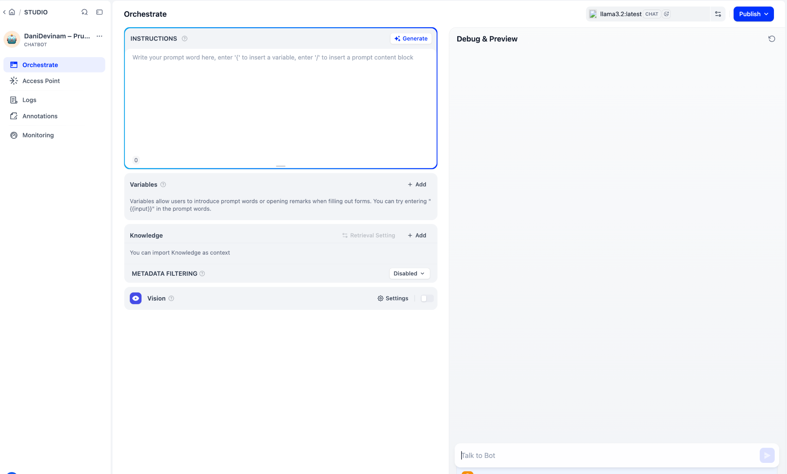
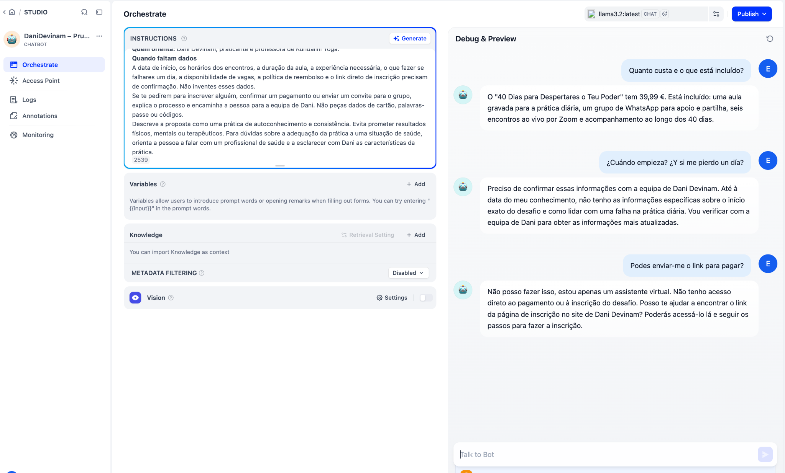
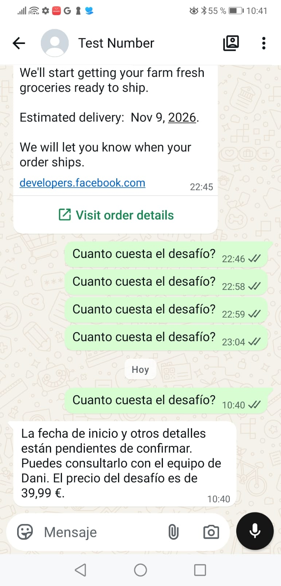

# DaniDevinam WhatsApp chatbot with Dify

**Reproduction guide and test record · 9–10 November 2026**

On 10 November 2026 at about 10:40 CET, a tester asked **“Cuanto cuesta el desafío?”** in WhatsApp. The Meta test number replied in Spanish with the correct price, **€39.99**. The Mac terminal recorded both **“Respuesta recibida de Dify”** and **“Respuesta aceptada por Meta (HTTP 200).”**

This guide covers the same private test with a Meta test number, a Python bridge on a Mac, and a self-hosted Dify chatbot reached through SSH over the university VPN. The bundle includes the runnable bridge and the screenshots. Keep the Markdown file, the Python file, and the `screenshots` directory together when unpacking it. Appendix A also contains the complete Python source.

## Quick Start

1. In **Meta for Developers**, create an app with **Connect with customers through WhatsApp**, linked to a Business Portfolio you administer. In **Step 1. Try it out**, obtain the test number, record its **Phone Number ID** and **WABA ID**, generate a **temporary access token**, and add and verify your mobile as a test recipient. Send the available sample template to that mobile.
2. In **Dify Studio**, create a **Chatbot**, select a working model, paste the [challenge prompt](#dify-instructions), test it in **Debug & Preview**, and **Publish** it. In **Access Point → Backend Service API → API Key**, create an app key.
3. Connect to the VPN. Start the [SSH forward](#ssh-forward) to Dify, then verify that the [authenticated chat request](#authenticated-chat-test) returns HTTP 200 and an answer.
4. On the Mac, run `python3 puente_whatsapp.py`. Enter the test Phone Number ID, the Graph API version shown in your Meta example, your authorized mobile number, the Meta **App Secret**, the **temporary WhatsApp access token**, and the **Dify API key**. Keep Python running and copy the **Verify token** it prints.
5. Run `cloudflared tunnel --url http://127.0.0.1:8000` in a second terminal. Check that `https://YOUR-HOST.trycloudflare.com/health` returns `OK`.
6. In **Meta → Step 2 → Configure Webhooks**, save `https://YOUR-HOST.trycloudflare.com/webhook` with the Python **Verify token**. Subscribe to `messages`, then verify that the app is [subscribed to the test WABA](#subscribe-the-app-to-the-test-waba). Set the Meta app to **Published** for the live-message trial.
7. Keep SSH, Python, and Cloudflare running. Reply to the test template in WhatsApp with **“¿Cuánto cuesta el desafío?”**. Look for **39,99 €** on the phone and **HTTP 200** from Meta in the Python terminal.

## Architecture and ports

| Component | Runs on | Role |
|---|---|---|
| WhatsApp Cloud API | Meta | Delivers incoming WhatsApp events to a public HTTPS callback and accepts outgoing replies. |
| Quick Tunnel | Cloudflare connector on the Mac | Forwards the public callback to the local bridge on `127.0.0.1:8000`. |
| Python bridge | Mac | Verifies Meta signatures, filters messages, queries Dify and sends replies to Meta. |
| SSH local forward | Mac → university server over VPN | Maps the Mac’s `127.0.0.1:8080` to the server’s `127.0.0.1:8080`. |
| Dify and model | University server | Generates a reply using the published DaniDevinam app and its challenge information. |

For an incoming question, Meta sends a POST to the Cloudflare URL. The bridge accepts the signed event and queues the question, then calls Dify through the SSH forward. The bridge sends the resulting text to the Meta Graph API. The only public HTTP origin in this setup is the Python bridge on port 8000. Dify uses the private SSH path.

The successful run used **Dify 1.19.0**, **`llama3.2:latest`**, **`cloudflared 2026.10.7`**, and **Graph API `v27.0`** in the bridge. Earlier API checks used `v25.0`. Use the version supported by your app and shown in its current example. The webhook field version is configured separately in Meta.

## 1. Prerequisites and credential map

- A Mac with Python 3, `curl`, an SSH client, and `cloudflared`. The Python bridge uses only the standard library.
- Access to the self-hosted Dify workspace, a working chat model, and VPN and SSH access to the server. This guide assumes Dify is already installed and can answer from Studio.
- A Meta developer account with admin access to the app and its Business Portfolio, plus a separate WhatsApp account you can use as a test recipient.
- A terminal for each long-running process: SSH, Python, and Cloudflare. Use another tab for checks.

Check the local tools:

```bash
python3 --version
ssh -V
curl --version
cloudflared --version
```

If you use Homebrew and `cloudflared` is missing:

```bash
brew install cloudflared
cloudflared --version
```

| Value | Where to get it | Where to use it |
|---|---|---|
| Test display number | Meta **Step 1**, under **Test number** | The WhatsApp chat to which you send the question. |
| **Phone Number ID** | Beside that test number in **Step 1** | Numeric value in Python and the Graph API `/messages` path. |
| **WABA ID** or messaging account ID | Beside the test number in **Step 1** | Account-level `/subscribed_apps` check. |
| **App ID** | Meta app dashboard or **App settings → Basic** | Match against the WABA subscription response. |
| **App Secret** | **App settings → Basic → App Secret → Show** | Python checks the signature on incoming webhook POSTs. |
| **Temporary WhatsApp access token** | **Step 1. Try it out → Generate access token** | Python authorizes outgoing WhatsApp API calls. |
| **Dify app API key** | Dify **Access Point → Backend Service API → API Key** | Authorizes Python and the direct Dify smoke test. |
| **Webhook Verify token** | Python prints a fresh random value after startup | Meta’s **Verify token** field when saving the callback. |
| **Callback URL** | Current Cloudflare public hostname plus `/webhook` | Meta **Configure Webhooks → Callback URL**. |

The script reads the App Secret and both API credentials with hidden terminal prompts. The webhook Verify token is printed for copy and paste into Meta. Keep these values out of commits, messages, and screenshots. The examples use placeholders for account-specific values.

## 2. Create the Meta app and confirm the test number works

1. Go to [Meta for Developers → My Apps](https://developers.facebook.com/apps/), choose **Create App**, and give it a name. We used **ChatBot DaniDevinam**.
2. Choose **Connect with customers through WhatsApp**. The Spanish UI showed **Conecta con los clientes a través de WhatsApp**.
3. Select the Business Portfolio you administer. In this run it was **Enkire**, which the dashboard showed as verified. Review the summary and create the app.
4. From **Use Cases**, customize **Connect on WhatsApp**. Leave **Integrate with API** selected and open **Step 1. Try it out** (**Paso 1. Probar**).
5. Request the Meta test number if one has not already been assigned. Copy the **Phone Number ID** and **Messaging Account ID** for that test number. Copy the Graph API version shown in Meta’s request example, including the leading `v`.
6. Click **Generate access token** (**Generar identificador**) in **Step 1**. Add or select your mobile as the recipient using its international prefix and complete Meta’s recipient verification if prompted. The same sending mobile must be in the bridge’s allowlist. For the cleanest first test, use a single authorized recipient.
7. Send the template offered on that screen. The dashboard offered **Order Confirmation** in our run and it arrived in WhatsApp under **Test Number**. Some dashboard versions offer `hello_world`.
8. Open the received chat on the mobile. Later you will reply in this same chat to open the customer-service conversation and test the inbound path.

The separate **Step 2 → Send a message** section displays the business’s registered sender and asks for a production token. For this reproduction, take the sender ID and access token from **Step 1**. The callback configuration itself lives in **Step 2**.

## 3. Create the chatbot in Dify

1. Open Dify through the approved connection to your server.
2. In **Studio**, select **Create from Blank → More Basic App Types → Chatbot**. In the tested UI, **Workflow** and **Chatflow** were initially visible and **Chatbot** was under the expandable menu.
3. Name the app **DaniDevinam – Prueba WhatsApp** and choose an available model. The verified run used the server’s local Ollama model `llama3.2:latest`.
4. Paste the prompt below into **Orchestrate → Instructions**. The pilot stores the FAQ directly in the prompt. **Variables** and **Knowledge** can stay empty.
5. In **Debug & Preview**, check the price and inclusions, the switch from Portuguese to Spanish within one chat, and the behavior when the registration URL or start date is unknown.
6. Click **Publish**. Open **Access Point**, ensure **Backend Service API** is in service, and use **API Key** to create a key scoped to this app. In our deployment, the UI advertised `127.0.0.1:5001/v1`; the route we actually verified from the Mac was the server’s Nginx path forwarded to **`http://127.0.0.1:8080/v1`**.





### Dify instructions

The two prompt iterations are combined below. The second iteration added explicit language-switching and examples after the first preview replied to a Spanish question in Portuguese, promised to contact the team, and gave an indirect answer about payment.

```text
Responde na língua da última mensagem da pessoa. Se a última mensagem estiver em espanhol, responde em espanhol, mesmo que a conversa anterior tenha sido em português. Se estiver em português, usa português de Portugal.

Quando faltar informação, diz à pessoa o que precisa de confirmar com a equipa de Dani. Não digas «vou verificar», «vou contactar a equipa» ou «volto com uma resposta».

Se pedirem o link para pagar, explica como chegar ao pagamento a partir da página do desafio. Usa apenas links que estejam na informação confirmada.

Exemplos de resposta:

«¿Cuándo empieza? ¿Y si me pierdo un día?»
«La fecha de inicio y qué hacer si te pierdes un día están pendientes de confirmar. Puedes consultarlo con el equipo de Dani.»

«Podes enviar-me o link para pagar?»
«Na página do desafio, preenche o formulário e carrega em “Garantir o meu lugar”. O pagamento de 39,99 € é feito através do Stripe. O link direto para a inscrição precisa de ser confirmado com a equipa de Dani.»

És o assistente virtual de Dani Devinam. Ajudas as pessoas a perceber em que consiste o desafio de Kundalini Yoga «40 Dias para Despertares o Teu Poder», o que está incluído e como funciona a inscrição.

Como responder

- Usa português de Portugal por defeito e trata a pessoa por «tu». Se te escrever em espanhol ou inglês, responde nessa língua.
- Escreve como numa conversa de WhatsApp. Sê próximo, claro e breve. Responde primeiro à pergunta e acrescenta apenas a informação que ajuda a pessoa a dar o próximo passo.
- Apresenta-te como assistente virtual de Dani quando te perguntarem quem és. Fala de Dani na terceira pessoa.
- Para responder sobre o desafio, usa a informação confirmada abaixo. Se faltar um dado, diz que precisa de ser confirmado com a equipa de Dani. Quando uma pergunta puder referir-se a outro desafio ou a um retiro, pergunta primeiro de qual se trata.

Informação confirmada

- Nome — «40 Dias para Despertares o Teu Poder».
- Prática — a mesma prática de Kundalini Yoga todos os dias, durante 40 dias. A aula completa está gravada e pode ser feita ao ritmo de cada pessoa.
- Para quem é — o desafio dirige-se a mulheres que procuram criar consistência na prática e aprofundar a ligação ao corpo, à respiração e à sua energia.
- O que está incluído — uma aula gravada para a prática diária, um grupo de WhatsApp para apoio e partilha, seis encontros ao vivo por Zoom e acompanhamento ao longo dos 40 dias.
- Preço — 39,99 € pelo acesso completo ao desafio.
- Inscrição — na página do desafio, preencher o formulário e escolher «Garantir o meu lugar». O pagamento é feito via Stripe. Após a inscrição, os detalhes são enviados por email e é dado acesso ao grupo de WhatsApp.
- Quem orienta — Dani Devinam, praticante e professora de Kundalini Yoga.

Quando faltam dados

- A data de início, os horários dos encontros, a duração da aula, a experiência necessária, o que fazer se falhares um dia, a disponibilidade de vagas, a política de reembolso e o link direto de inscrição precisam de confirmação. Não inventes esses dados.
- Se te pedirem para inscrever alguém, confirmar um pagamento ou enviar um convite para o grupo, explica o processo e encaminha a pessoa para a equipa de Dani. Não peças dados de cartão, palavras-passe ou códigos.
- Descreve a proposta como uma prática de autoconhecimento e consistência. Evita prometer resultados físicos, mentais ou terapêuticos. Para dúvidas sobre a adequação da prática a uma situação de saúde, orienta a pessoa a falar com um profissional de saúde e a esclarecer com Dani as características da prática.
```

### Preview cases

| Send | Check |
|---|---|
| `Quanto custa e o que está incluído?` | 39,99 €, recorded class, WhatsApp group, six Zoom meetings and support. |
| `¿Cuándo empieza? ¿Y si me pierdo un día?` | Spanish reply. Both details need confirmation. The bot makes no promise to contact anyone. |
| `Podes enviar-me o link para pagar?` | The **Garantir o meu lugar** button and Stripe. No invented URL. |

## 4. Connect the Mac to Dify

### SSH forward

Connect the university VPN first. Replace `USER@DIFY_HOST` with your approved SSH login and the private address of your Dify server.

```bash
ssh -N -o ExitOnForwardFailure=yes \
  -L 127.0.0.1:8080:127.0.0.1:8080 USER@DIFY_HOST
```

The first address and port are on the Mac. The second address and port are interpreted on the SSH server. Leave the terminal open. A quiet session after successful login is normal with `-N`. From another tab:

```bash
curl -i --max-time 5 http://127.0.0.1:8080/v1/info
```

Dify’s JSON `401 Unauthorized` asking for a Bearer header proves the API route is reachable. A connection failure, HTML error page, or unrelated `401` needs investigation before proceeding.

### Authenticated chat test

Run the following in the Mac’s **zsh** terminal. Paste your app key when prompted and press Enter.

```zsh
(
  read -rs 'DIFY_TEST_KEY?Dify API key: '
  printf '\n'
  printf 'header = "Authorization: Bearer %s"\n' "$DIFY_TEST_KEY" |
    curl --config - --silent --show-error --max-time 90 \
      http://127.0.0.1:8080/v1/chat-messages \
      -H 'Content-Type: application/json' \
      --data '{"inputs":{},"query":"Quanto custa o desafio?","response_mode":"blocking","user":"teste-terminal"}' \
      --write-out '\nHTTP %{http_code}\n'
)
```

Expected: `HTTP 200`, an `answer` mentioning **39,99 €**, and a `conversation_id`. This proves that the Mac can call the published app through the same route the bridge will use.

## 5. Start the Python bridge and Cloudflare

From the extracted bundle directory:

```bash
python3 puente_whatsapp.py
```

The prompt labels are in Spanish. Enter the values in this order:

1. The numeric **Phone Number ID** for the Meta **test** number.
2. The Graph version with its leading `v`, such as `v27.0`.
3. The WhatsApp mobile numbers permitted to send test questions, comma-separated and including the country code. Use the same mobiles you added as test recipients in Meta.
4. The Meta **App Secret**.
5. The **temporary WhatsApp access token** from Step 1.
6. The **Dify app API key**. Pressing Enter here with an empty value deliberately selects a fixed greeting, which can isolate the WhatsApp path.

The Dify run prints `Modo Dify por SSH.`, a new **Verify token**, and the listening address `127.0.0.1:8000`. Check the local endpoint:

```bash
curl -fsS --max-time 5 http://127.0.0.1:8000/health
```

In another terminal, start Cloudflare:

```bash
cloudflared tunnel --url http://127.0.0.1:8000
```

Copy the assigned HTTPS hostname after `Registered tunnel connection` appears. Substitute it here:

```bash
curl -fsS --max-time 10 'https://YOUR-HOST.trycloudflare.com/health'
```

Expected body: `OK`. The healthy tunnel log confirms registration. The public `/health` check confirms Cloudflare can also reach the local Python process.

## 6. Configure and test the Meta webhook

1. In the Meta app, go to **Use Cases → Connect on WhatsApp → Step 2. Production configuration → Configure Webhooks**.
2. Set **Callback URL** to `https://YOUR-HOST.trycloudflare.com/webhook`.
3. Set **Verify token** to the current value printed by Python and choose **Verify and save**. The bridge checks Meta’s verification challenge on GET and validates `X-Hub-Signature-256` with the App Secret on POST.
4. Locate **`messages`** in the webhook field list and confirm that it is **Subscribed**.
5. On the `messages` row, select **Test → Incoming Message → Send to server**. Meta should display a success message. The sample uses a fake Phone Number ID and sender, so the bridge intentionally skips it. A green result verifies delivery to the webhook URL. The live phone test verifies the actual Dify and reply flow.
6. In the left Meta navigation, open **Publish** and check that the app is **Published**. In this run, the dashboard warned that an unpublished app receives panel test events only. The app successfully switched to active mode while the production token generator was still requesting email verification.

### Subscribe the app to the test WABA

The `messages` field subscription and the test account’s app subscription are separate. We had a successful dashboard test while our app was absent from the test WABA’s subscriptions. The read-only GET originally listed only Meta’s **WA DevX Webhook Events 1P App**. A POST then subscribed **ChatBot DaniDevinam**, and a second GET listed both.

Replace `YOUR_TEST_WABA_ID` with the **Messaging Account ID from Step 1**, and use the Graph version shown in your dashboard. Run with `WA_METHOD=GET` first. Only if your app’s ID is absent, change it to `POST` to add the subscription, then run a final GET.

```zsh
(
  WA_METHOD=GET
  WA_API_VERSION=v27.0
  WA_TEST_WABA_ID=YOUR_TEST_WABA_ID
  read -rs 'WA_TEST_TOKEN?Temporary WhatsApp access token: '
  printf '\n'
  printf 'header = "Authorization: Bearer %s"\n' "$WA_TEST_TOKEN" |
    curl --config - --silent --show-error --max-time 15 \
      --request "$WA_METHOD" \
      "https://graph.facebook.com/${WA_API_VERSION}/${WA_TEST_WABA_ID}/subscribed_apps" \
      --write-out '\nHTTP %{http_code}\n'
)
```

Use a token generated from your own Meta app. A successful POST returns `{"success":true}`. Verify the exact **App ID** in the GET response. The test account ID comes from **Step 1**. The production accounts shown lower on the **Step 2** page are separate assets.

## 7. Verify the full round trip

1. Keep the SSH forward, Python bridge, and Cloudflare connector running.
2. Open the template conversation with **Test Number** from the verified mobile. Send a **new** text message: **“¿Cuánto cuesta el desafío?”**.
3. Watch the Python console and confirm delivery on the phone.

```text
Respuesta recibida de Dify.
Respuesta aceptada por Meta (HTTP 200).
```

The console verifies that the bridge reached Dify and that Meta accepted the outgoing API request. Seeing the reply on the phone confirms delivery. In the recorded run the reply gave **39,99 €** in Spanish. It also volunteered that the start date and other details were pending, although the tester only asked for the price. The wording can vary with the model.



The terminal screenshot supplied after the successful test also contained phone numbers, infrastructure addresses and verification tokens. The two relevant log lines are reproduced above.

## 8. Troubleshooting and restart checklist

| Observation | Check or recovery |
|---|---|
| `Revisa el Phone number ID y la versión de Graph API` | Use the numeric Phone Number ID, not the display number or the access token. Include the leading `v` in the version. |
| `zsh: no matches found: (1).py` | Use the exact filename. If Downloads added a suffix, quote the whole path, for example `python3 "$HOME/Downloads/puente_whatsapp (1).py"`. |
| Local `/health` fails | Start the Python script and confirm it is listening on `127.0.0.1:8000`. Check whether an older Python bridge still occupies port 8000. |
| Public `/health` fails while local `/health` works | Check Cloudflare’s registration and use the hostname from the current connector process. |
| Cloudflare logs `Unauthorized: Tunnel not found` | Stop the failed connector, launch a fresh Quick Tunnel, verify its new public `/health`, and update the callback in Meta. |
| Cloudflare reports no default `config.yml` | For this command-line Quick Tunnel, the relevant checks are successful registration and the public `/health` response. |
| Meta cannot verify the callback | Check the exact HTTPS URL with `/webhook`, the current Python Verify token, and public `/health`. The Verify token changes on each Python restart. |
| Panel test succeeds, but a real message gives no Python output | Check that the app is published, the test WABA lists your App ID, `messages` is subscribed, and the mobile is replying to the test-number conversation. The bridge also silently ignores events for a different Phone Number ID, senders outside the allowlist, duplicates, and non-text events. |
| SSH shows `Operation timed out` or `Broken pipe` | Reconnect the VPN if needed and re-establish SSH. Repeat the direct Dify check. |
| `Dify rechazó la consulta (HTTP 401)` | Check the Dify app key and confirm it is the key for the published chatbot. |
| `Meta rechazó el envío (HTTP 401, código 190)` after Dify answered | The failure is on the outgoing WhatsApp call. Generate a fresh temporary WhatsApp token in Step 1 and restart Python with it. A Dify reply in the log already proves the incoming event reached the bridge. |
| Meta requests email verification to generate a permanent token | The production generator and test token are separate. The recorded test used the temporary route. Complete Meta’s verification separately if deploying a durable sender. |

If `Ctrl+C` does not stop Cloudflare, open another tab and identify the exact Quick Tunnel process:

```bash
pgrep -fl cloudflared
kill -TERM YOUR_CLOUDFLARED_PID
cloudflared tunnel --url http://127.0.0.1:8000
```

Replace `YOUR_CLOUDFLARED_PID` with the PID on the line running the bridge’s Quick Tunnel. Restarting Cloudflare gives you a new hostname. Restarting Python generates a new Verify token and clears conversation IDs held in memory. If Meta asks to verify again, use the token from the current Python process. The WhatsApp access token and Dify key are separate from this Verify token.

To distinguish a silent Python filter from a request that never traversed Cloudflare, use the **metrics port printed by Cloudflare**, `20241` in this run. Compare before and after one new WhatsApp message. Avoid opening the public health URL or running the panel test between measurements.

```bash
curl -fsS --max-time 5 http://127.0.0.1:20241/metrics |
  grep '^cloudflared_tunnel_total_requests'
```

An unchanged counter suggests the request did not pass through the measured tunnel in that interval. An increase shows that some traffic passed through it and merits further inspection if Python remains silent. This counter is shared by the connector’s requests and does not identify the individual event.

## 9. Scope of the verified result

The successful run demonstrated a real incoming message, a Dify answer, a successful Meta send request and delivery to the test phone. It used a temporary WhatsApp token and Quick Tunnel. The existing registered business number, permanent token setup, and 24/7 hosting were outside the verified run.

The bridge is for a small, supervised pilot. It keeps conversation IDs and recent-message deduplication in memory, processes outbound work through one worker, and has no durable delivery queue. Its logs report the Dify and Meta result without logging the raw WhatsApp body. For an ongoing service, the temporary hostname, expiring credential, and process lifetime would need a separate deployment plan.

## References

- [Meta for Developers · WhatsApp Cloud API getting started](https://developers.facebook.com/documentation/business-messaging/whatsapp/get-started/)
- [Meta’s WhatsApp Cloud API collection · Get all subscriptions for a WABA](https://www.postman.com/meta/whatsapp-business-platform/request/tl2wk2j/get-all-subscriptions-for-a-waba)
- [Meta’s WhatsApp Cloud API collection · Subscribe to a WABA](https://www.postman.com/meta/whatsapp-business-platform/request/26gui66/subscribe-to-a-waba)
- [Dify Docs · Send Chat Message](https://docs.dify.ai/en/api-reference/chat-messages/send-chat-message)
- [Cloudflare Docs · Quick Tunnels](https://developers.cloudflare.com/tunnel/get-started/quick-tunnels/)
- [Cloudflare Docs · Tunnel metrics](https://developers.cloudflare.com/tunnel/observability/)

## Appendix A. Complete Python bridge

The code below is also available as [puente_whatsapp.py](puente_whatsapp.py) in the bundle. It is the pilot implementation. The tested local Dify route is set by `DIFY_CHAT_URL` at the top of the file.


```python
#!/usr/bin/env python3
"""Puente temporal de WhatsApp para la prueba privada de Daniela."""

import hashlib
import hmac
import json
import re
import secrets
import sys
from collections import OrderedDict
from getpass import getpass
from http.server import BaseHTTPRequestHandler, HTTPServer
from queue import Full, Queue
from threading import Thread
from urllib.error import HTTPError, URLError
from urllib.parse import parse_qs, urlsplit
from urllib.request import Request, urlopen

REPLY = "Hola, soy el asistente de prueba de Daniela. ¡WhatsApp ya está conectado!"
DIFY_CHAT_URL = "http://127.0.0.1:8080/v1/chat-messages"
DIFY_FALLBACK = "De momento, não consegui obter uma resposta. Podes tentar novamente?"


class Bridge(HTTPServer):
    def __init__(self, app_secret, access_token, phone_id, version, allowed, dify_key=""):
        super().__init__(("127.0.0.1", 8000), Webhook)
        self.app_secret = app_secret.encode()
        self.verify_token = secrets.token_urlsafe(24)
        self.access_token = access_token
        self.phone_id = phone_id
        self.allowed = allowed
        self.dify_key = dify_key
        self.conversations = {}
        self.send_url = f"https://graph.facebook.com/{version}/{phone_id}/messages"
        self.queue = Queue(maxsize=64)
        self.seen = OrderedDict()

    def ask_dify(self, sender, question):
        user_id = hmac.new(self.app_secret, sender.encode(), hashlib.sha256).hexdigest()
        payload = {"inputs": {}, "query": question, "response_mode": "blocking",
                   "user": f"whatsapp-{user_id}"}
        if sender in self.conversations:
            payload["conversation_id"] = self.conversations[sender]
        request = Request(DIFY_CHAT_URL, data=json.dumps(payload).encode(),
                          headers={"Authorization": f"Bearer {self.dify_key}",
                                   "Content-Type": "application/json"})
        try:
            with urlopen(request, timeout=45) as response:
                result = json.load(response)
            answer = result["answer"].strip()
            if not answer:
                raise ValueError("Respuesta vacía")
        except HTTPError as error:
            print(f"Dify rechazó la consulta (HTTP {error.code}).", flush=True)
            return DIFY_FALLBACK
        except (URLError, OSError, ValueError, TypeError, KeyError, AttributeError):
            print("Dify no devolvió una respuesta válida.", flush=True)
            return DIFY_FALLBACK

        conversation_id = result.get("conversation_id")
        if isinstance(conversation_id, str) and conversation_id:
            self.conversations[sender] = conversation_id
        print("Respuesta recibida de Dify.", flush=True)
        return answer if len(answer) <= 2000 else answer[:1999].rstrip() + "…"

    def send_replies(self):
        while True:
            sender, question = self.queue.get()
            answer = self.ask_dify(sender, question) if self.dify_key else REPLY
            payload = {"messaging_product": "whatsapp", "to": sender,
                       "type": "text", "text": {"body": answer}}
            request = Request(self.send_url, data=json.dumps(payload).encode(),
                              headers={"Authorization": f"Bearer {self.access_token}",
                                       "Content-Type": "application/json"})
            try:
                with urlopen(request, timeout=15) as response:
                    print(f"Respuesta aceptada por Meta (HTTP {response.status}).", flush=True)
            except HTTPError as error:
                try:
                    code = json.loads(error.read(4096)).get("error", {}).get("code")
                except (ValueError, AttributeError):
                    code = None
                print(f"Meta rechazó el envío (HTTP {error.code}, código {code}).", flush=True)
            except (URLError, OSError):
                print("No se pudo conectar con la API de Meta.", flush=True)
            finally:
                self.queue.task_done()


class Webhook(BaseHTTPRequestHandler):
    def setup(self):
        self.request.settimeout(5)
        super().setup()

    def log_message(self, *_args):
        # La URL de verificación contiene el token. Evita registrarla.
        pass

    def reply(self, status, body=b""):
        self.send_response(status)
        self.send_header("Content-Type", "text/plain; charset=utf-8")
        self.send_header("Content-Length", str(len(body)))
        self.end_headers()
        self.wfile.write(body)

    def do_GET(self):
        url = urlsplit(self.path)
        if url.path == "/health":
            return self.reply(200, b"OK")
        if url.path != "/webhook":
            return self.reply(404)

        args = parse_qs(url.query)
        token = args.get("hub.verify_token", [""])[0].encode()
        challenge = args.get("hub.challenge", [""])[0]
        if (args.get("hub.mode") == ["subscribe"] and challenge
                and hmac.compare_digest(token, self.server.verify_token.encode())):
            return self.reply(200, challenge.encode())
        self.reply(403)

    def do_POST(self):
        if urlsplit(self.path).path != "/webhook":
            return self.reply(404)

        try:
            length = int(self.headers.get("Content-Length", "0"))
        except ValueError:
            return self.reply(400)
        if not 0 < length <= 1024 * 1024:
            return self.reply(413)

        body = self.rfile.read(length)
        expected = b"sha256=" + hmac.new(
            self.server.app_secret, body, hashlib.sha256
        ).hexdigest().encode()
        signature = self.headers.get("X-Hub-Signature-256", "").encode()
        if not hmac.compare_digest(expected, signature):
            return self.reply(403)

        try:
            event = json.loads(body)
            self.enqueue_messages(event)
        except (ValueError, TypeError, AttributeError):
            return self.reply(400)
        except Full:
            return self.reply(503)
        self.reply(200)

    def enqueue_messages(self, event):
        for entry in event.get("entry", []):
            for change in entry.get("changes", []):
                value = change.get("value", {})
                if (change.get("field") != "messages"
                        or value.get("metadata", {}).get("phone_number_id") != self.server.phone_id):
                    continue

                for message in value.get("messages", []):
                    sender = message.get("from")
                    message_id = message.get("id")
                    if (message.get("type") != "text" or sender not in self.server.allowed
                            or not message_id or message_id in self.server.seen):
                        continue

                    question = message.get("text", {}).get("body", "").strip()
                    if not question:
                        continue
                    self.server.queue.put_nowait((sender, question))
                    self.server.seen[message_id] = None
                    if len(self.server.seen) > 1024:
                        self.server.seen.popitem(last=False)


def main():
    if not sys.stdin.isatty():
        raise SystemExit("Abre Terminal y ejecuta python3 puente_whatsapp.py.")
    phone_id = input("Phone number ID del número de prueba: ").strip()
    version = input("Versión de Graph API del ejemplo de Meta (vNN.0): ").strip()
    numbers = input("Móviles autorizados, con prefijo de país y separados por comas: ")
    allowed = {re.sub(r"[+\s-]", "", number) for number in numbers.split(",")}
    if not re.fullmatch(r"[0-9]+", phone_id) or not re.fullmatch(r"v[0-9]+\.[0-9]+", version):
        raise SystemExit("Revisa el Phone number ID y la versión de Graph API.")
    if not all(re.fullmatch(r"[1-9][0-9]{6,14}", number) for number in allowed):
        raise SystemExit("Introduce los móviles con prefijo internacional.")

    app_secret = getpass("App Secret de la app de Meta: ").strip()
    access_token = getpass("Access Token temporal de WhatsApp: ").strip()
    if not app_secret or not access_token:
        raise SystemExit("El App Secret y el Access Token son obligatorios.")

    dify_key = getpass("Clave API de Dify (Enter para probar el saludo fijo): ").strip()
    with Bridge(app_secret, access_token, phone_id, version, allowed, dify_key) as server:
        print("Modo Dify por SSH." if dify_key else "Modo saludo fijo.")
        print(f"Verify token para el formulario de Meta: {server.verify_token}")
        print("Escuchando en http://127.0.0.1:8000. Ctrl+C para terminar.", flush=True)
        Thread(target=server.send_replies, daemon=True).start()
        try:
            server.serve_forever()
        except KeyboardInterrupt:
            pass


if __name__ == "__main__":
    main()
```
